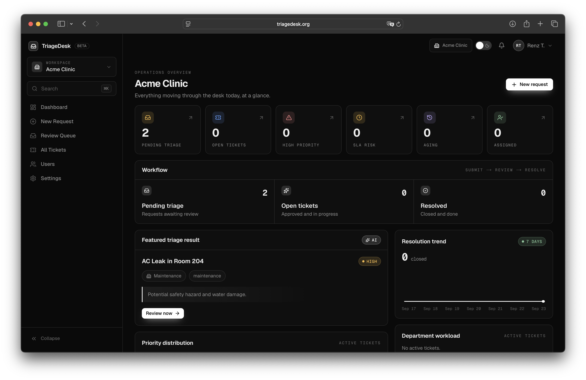

# TriageDesk


TriageDesk is an AI triage tool for operations requests in schools, clinics, offices, and facilities teams. Staff describe a problem, AI drafts a priority and department, and an admin reviews the draft before it becomes a tracked ticket.



## Features

- Workspaces with invite codes and requester, admin, and owner roles
- AI triage drafts that an admin approves, rejects, or marks as a duplicate
- Tickets with activity history and in-app notifications
- Private file attachments on requests
- A no-account live demo that gives each visitor a temporary workspace

## Requirements

- Node.js 24
- pnpm 10
- Accounts on Clerk, Supabase, and Groq

## Setup

1. Install dependencies.

   ```sh
   pnpm install
   ```

2. Create your local env file.

   ```sh
   cp .env.example .env.local
   ```

3. **Clerk:** create an app and copy its keys into `.env.local`. Turn on email/password sign-in with email codes. Turn on Google if you want Google sign-in.

4. **Supabase:** create a project and run these in the SQL editor, in order:
   - `supabase/schema.sql` creates the tables and the private `request-attachments` bucket. It is safe to run again.
   - `supabase/reset_workspace_seed.sql` fills the Demo Clinic workspace with sample data. The live demo copies this workspace, so skip it and demos start empty.

5. **Groq:** create an API key and add it to `.env.local`.

6. Set `SEED_ADMIN_EMAIL` to the email you will sign up with. That account becomes the owner.

7. Start the app and open `http://localhost:3000/api/health`. It should return `ok: true`.

   ```sh
   pnpm dev
   ```

## Configuration

Required:

```env
AI_PROVIDER=groq
GROQ_API_KEY=
NEXT_PUBLIC_CLERK_PUBLISHABLE_KEY=
CLERK_SECRET_KEY=
NEXT_PUBLIC_SUPABASE_URL=
SUPABASE_SERVICE_ROLE_KEY=
SEED_ADMIN_EMAIL=
```

Required in production:

- `RATE_LIMIT_SALT`: salt for the hashed rate-limit keys. Generate it with `openssl rand -hex 32`.

Optional:

- `DEMO_SESSION_SECRET`: turns on the live demo. Generate it with `openssl rand -hex 32`. Left blank, the demo stays off.
- `DEMO_ENABLED=false`: turns the demo off without a deploy.
- `NEXT_PUBLIC_SITE_URL`: the app's public URL. Defaults to `VERCEL_URL`, then `http://localhost:3000`.
- `NEXT_PUBLIC_CONTACT_EMAIL`: the support email shown on the landing page. It ends up in the browser bundle, so it is public.
- `SUPABASE_REQUEST_ATTACHMENTS_BUCKET`: the attachment bucket name. Defaults to `request-attachments`.
- `HEALTHCHECK_TOKEN`: unlocks detailed `/api/health` output in production.
- `GROQ_MODEL`, `GROQ_MAX_COMPLETION_TOKENS`, `GROQ_REASONING_EFFORT`: tune the AI model. The defaults work.
- `SENTRY_*` and `NEXT_PUBLIC_SENTRY_DSN`: error monitoring.
- `SUPABASE_ACCESS_TOKEN`: used only by the Supabase MCP server. Copy `.mcp.json.example` to `.mcp.json` to use it.

Keep `CLERK_SECRET_KEY`, `SUPABASE_SERVICE_ROLE_KEY`, and `DEMO_SESSION_SECRET` on the server only, and never commit real keys.

## How to Run

```sh
pnpm dev                  # development server
pnpm build && pnpm start  # production build
```

Run these checks before opening a pull request. CI runs all of them, plus `pnpm build`.

```sh
pnpm lint
pnpm typecheck
pnpm test
```

## Important Notes

- **Authorization lives in the app code.** Supabase is only a database here; Clerk handles sign-in. The app connects with the service-role key, which bypasses Row Level Security, so a missing permission check in `lib/auth.ts` or `lib/workspaces.ts` has no database backstop.
- **Admins make the final call.** A new request waits for admin review. When Groq fails, the app falls back to keyword rules and logs the fallback.
- **Hazard language is never Low priority.** A keyword-based safety check raises the priority of any request that mentions a hazard.
- **The AI sees only the request text.** Groq receives the description, location, and urgency note. It never sees attachments, contact names, or who sent the request.
- **Submitting a request:** only the description is required. Attachments can be JPG, PNG, WebP, PDF, DOCX, TXT, CSV, or JSON, with up to 3 files per request at 10 MiB each.
- **Limits:** each user can have 3 workspaces. Each workspace allows 20 members, 5 active invites, and 10 custom departments. Submissions, uploads, and admin actions are rate-limited.
- **Live demo:** demo workspaces expire after 4 hours. Demo visitors cannot upload files, invite members, or change account settings. The `demo-clinic` workspace is read-only.

## Tech Stack

- Next.js 16, React 19, TypeScript 6, Tailwind CSS 4
- Clerk for sign-in
- Supabase for the database and file storage
- Groq for AI triage
- Zod for validation, Vitest for tests
- Sentry for error monitoring (optional)

## License

Copyright (c) 2026 Renz Tolentino. All rights reserved.

This is a private repository. Access does not grant permission to copy, redistribute, or reuse the source.
